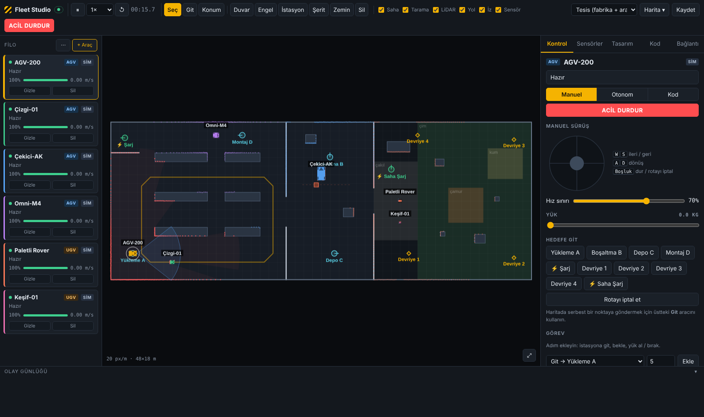
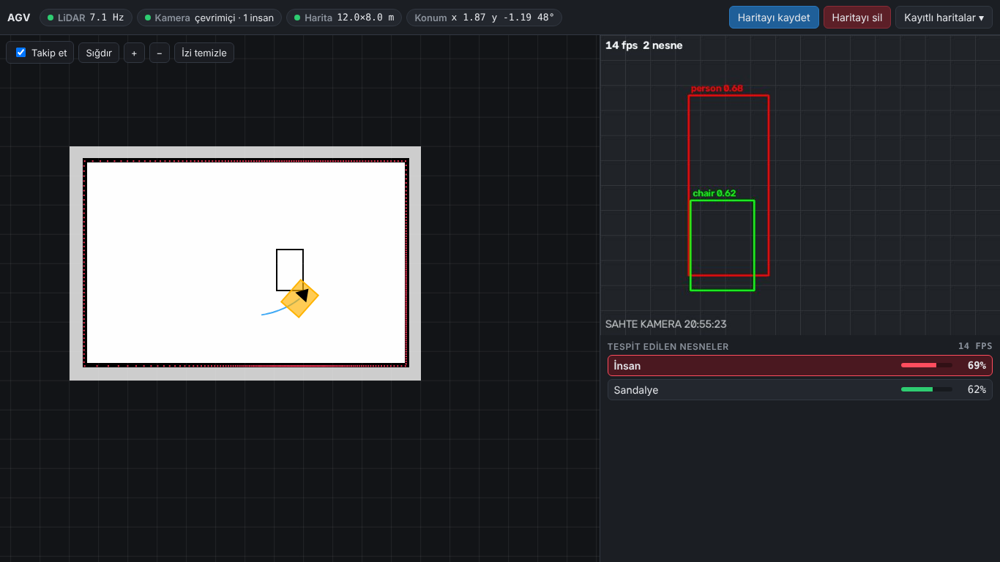

# AGV / UGV Platform

Software for my **200 kg AGV** (automated guided vehicle) and my tracked UGVs: a fleet simulator and control panel, the on-robot stack for mapping and perception, and a low-latency ESP-NOW remote.

> Status: active development. The AGV is tested in a classroom for now (desks, people), with factory use as the goal.



## What is inside

| Folder | What it is | Tech |
|---|---|---|
| [`fleet-studio/`](fleet-studio) | **AGV-UGV Fleet Studio** — simulator + real-vehicle control panel. Simulated and real vehicles run on the same map with the same UI, task system and code API. | Node.js, Electron, WebSocket, A* + pure pursuit |
| [`pi/`](pi) | **On-robot stack (Raspberry Pi 4)** — LiDAR SLAM mapping, AI Camera object detection and a WebSocket gateway for the Windows app. One command starts everything; one web page shows the live map and camera. | ROS 2 Humble (Docker), RPLIDAR A1M8, Raspberry Pi AI Camera (IMX500), Python |
| [`esp-now-remote/`](esp-now-remote) | **Gamepad remote over ESP-NOW** — PC → ESP32-S3 → ESP-NOW → ESP32 → Arduino Mega → 2× BTS7960, with layered fail-safes. | Python (pygame), ESP32 Arduino, Arduino Mega |

### Fleet Studio highlights

- Drive models: differential, tracked / skid-steer, Ackermann, mecanum — with acceleration limits, motor delay and load-dependent braking
- Simulated sensors: 2D LiDAR, ultrasonic, camera detections, line sensor, encoder, IMU, GPS, bumper
- Encoder-less mode: open-loop odometry that drifts from the true pose, so you can see the error
- Indoor factory + outdoor terrain (grass, gravel, sand, mud) that changes speed, slip and battery use
- Autonomy: A* planning with terrain cost, pure-pursuit tracking, LiDAR safety layer, re-planning
- Tasks (go to station, wait, load / unload, loop), map editor, vehicle design calculator
- Windows installer and Linux AppImage via `npm run dist:win` / `npm run dist:linux`

### On-robot panel



### ESP-NOW remote safety layers

| If this happens | Who stops the robot | Time |
|---|---|---|
| PC app closes / gamepad disconnects | PC sends E-STOP, ARM drops | instant |
| USB cable unplugged | TX ESP32 | 300 ms |
| Radio link lost / out of range | RX ESP32 | 250 ms |
| RX–Mega cable broken | Arduino Mega | 200 ms |
| E-stop button | Mega latches, driver EN pins LOW | instant |

> A hardware mushroom e-stop on the motor battery line is still required on a 200 kg vehicle.

## Quick start

```bash
# Fleet Studio (Node.js 18+)
cd fleet-studio && npm install && npm start        # or: npm run server -> http://127.0.0.1:8765

# On the Raspberry Pi
bash pi/agv.sh                                      # then open http://<PI-IP>:8080

# ESP-NOW remote (PC side)
pip install pygame pyserial && python esp-now-remote/agv_kumanda.py --port COM6
```

Each folder has its own detailed README (in Turkish).

## Configuration notes

- `esp-now-remote`: put the MAC address of each ESP32 into the other one's sketch (`RX_MAC` / `TX_MAC`). They are printed on the Serial Monitor at boot.
- `fleet-studio/firmware/esp32_udp_agv`: set your own Wi-Fi name and password (`WIFI_SSID` / `WIFI_PASS`) before flashing. Do not commit real values.

## License

MIT — see [LICENSE](LICENSE).
